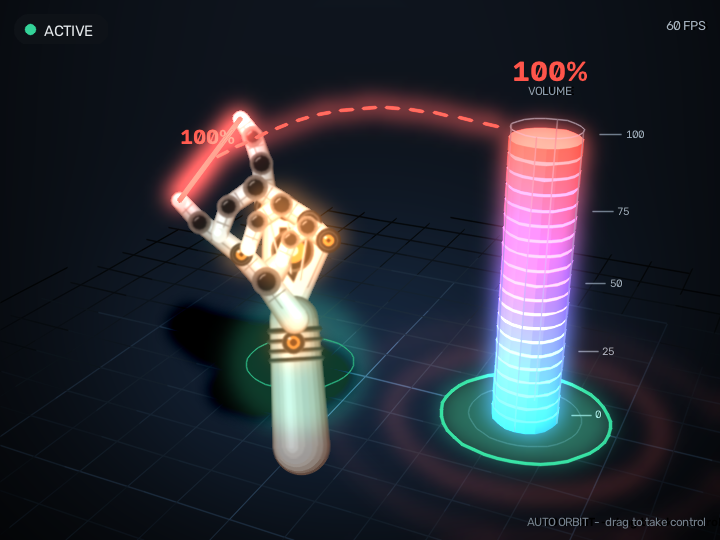
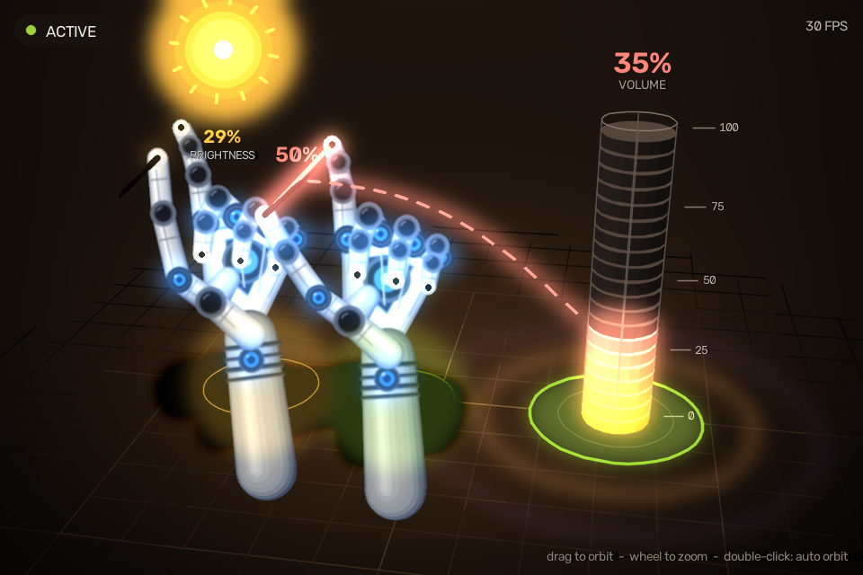
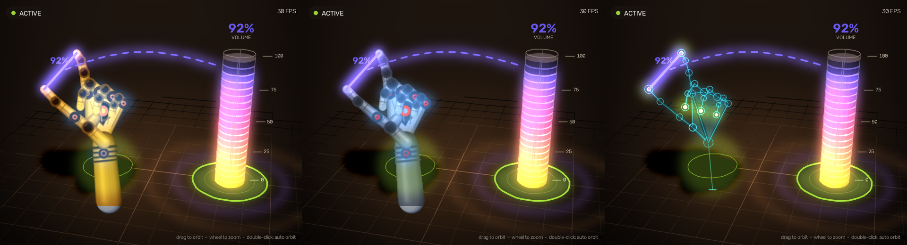
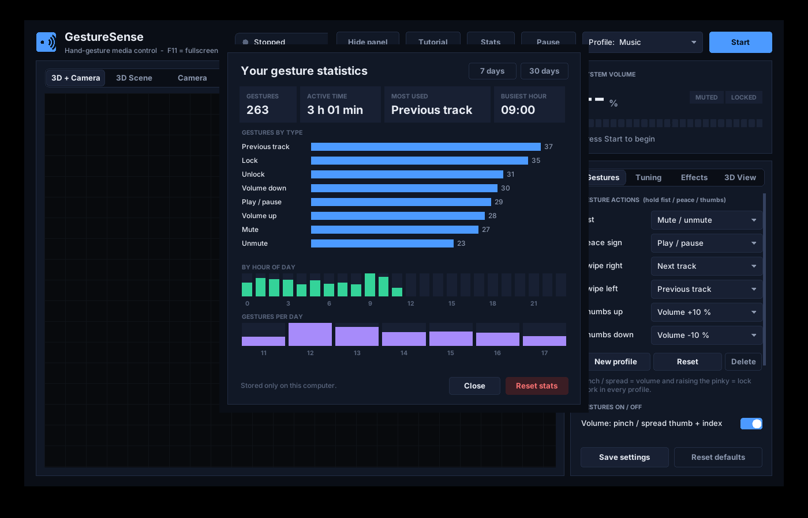

# GestureSense

**Control your computer's volume, media and screen brightness with hand gestures, using only a
webcam.** Hand tracking drives your system volume and shortcuts, while a 3D view drawn from scratch
with NumPy and OpenCV shows your hand and a volume tower live.

## Features
- **Real-time hand tracking** with MediaPipe HandLandmarker (21 landmarks, in 2D and real 3D).
- **Gesture control** for volume, mute, play/pause, track skipping and more. Every gesture can be
  remapped, and you can keep several **profiles** (Music, Presentation, Video call, Gaming, or
  your own). Profiles can switch automatically by the active app.
- **Two-hand mode**: the main hand controls volume, a second hand pinches to set screen brightness.
- **Software 3D renderer**: orbit camera, perspective projection, depth sorting, glow, shadows, a
  lit volume tower on a floor grid. No 3D engine involved.
- **Seven hand styles** (white android, gold, carbon, hologram, robot, human, glass) and five
  colour themes.
- **Stable tracking**: One-Euro jitter filter, hand-lost recovery, calibration wizard.
- **Safe by design**: volume moves at most 5 % per frame, a pinky lock, auto-lock when no hand is
  seen, and a re-acquire delay so the volume can never jump when your hand comes back.
- **Everyday polish**: first-run tutorial, sound effects, global pause hotkey (`Ctrl+Alt+G`),
  system tray, usage statistics, screenshot and recording, one-click launcher, `.exe` build script.

| Two-hand mode | Hand styles | Statistics |
|---|---|---|
|  |  |  |

## Gestures
| Gesture | Default action |
|---|---|
| Pinch / spread thumb and index finger | Volume down / up |
| Raise the pinky | Lock the volume (lower it to unlock) |
| Fist, hold about 0.7 s | Mute / unmute |
| Peace sign, hold about 0.7 s | Play / pause |
| Open palm, swipe right / left | Next / previous track |
| Thumbs up / down (hold to repeat) | Volume up / down 10 % |
| Second hand pinch (two-hand mode) | Screen brightness |

Open the *Gestures* tab to change any of these. Thumbs gestures assume an upright hand.

## Install and run
You need **Python 3.10 or newer** (developed on 3.12, also runs on 3.14) and a webcam. Windows is
the target platform; the gesture logic and the renderer also run on Linux and macOS for development
and tests.

1. Install Python from https://python.org (tick "Add python.exe to PATH").
2. Double-click **`GestureSense.bat`**. The first run creates `.venv`, installs the packages and
   downloads the hand model (internet needed), then opens the app with no console window.
   Use `run.bat` instead if you want to see console output.
3. Click **Start** (or enable *Start the camera when the app opens* in the Effects tab).
4. Optional: double-click `create_desktop_shortcut.bat` once to get a Desktop icon.

Manual setup:

    python -m venv .venv
    .venv\Scripts\activate
    pip install -r requirements.txt
    python main.py            # or: python -m gesturesense

No webcam? Try the renderer on its own: `python -m gesturesense.demo3d` (animated synthetic hand;
`--save out.png` writes one frame, which is how the screenshots above were made).

## Project structure
The code is a package with one-way layers: lower layers never import from higher ones.

    gesturesense/
      paths.py, version.py     where files live, app name and version
      config/                  settings.py (defaults, load/save), profiles.py
      core/                    hardware-free logic: gestures, filters, calibration, actions,
                               twohand, autoswitch, stats, tutorial_logic
      render/                  3D renderer: constants, theme, camera, layers, hands, world, scene
                               (Scene3D), plus 2D effects
      system/                  Windows integration: audio (Pycaw), sounds, hotkey and tray,
                               capture, model download
      ui/                      Tkinter app: widgets, app window, wizard, tutorial, stats window
      worker.py                camera thread: camera -> MediaPipe -> gestures -> 3D render
      launcher.py              start-up (logging, DPI, error dialog); main.py is a thin shim
      demo3d.py                webcam-free demo
    tests/                     simulated-hand tests, no camera or speakers needed
    docs/                      screenshots
    GestureSense.bat, run.bat, build_exe.bat, create_desktop_shortcut.bat

`core/` has no GUI or audio imports: the gesture engine takes an injectable audio object and key
presser, which is why the whole logic can be tested with simulated hands.

## Tests
    python -m unittest discover -s tests

Linting and formatting use [ruff](https://docs.astral.sh/ruff/) (`ruff check .`, `ruff format .`,
line length 100, configured in `pyproject.toml`).

## Build a Windows app
Double-click `build_exe.bat`, then share `dist\GestureSense`. Put `hand_landmarker.task` next to the
project first if you want the model bundled; otherwise it is downloaded on first start. A built app
keeps its settings in `%APPDATA%\GestureSense`; set `GESTURESENSE_HOME` to choose another folder.

## Tips
- Use good front lighting, keep your hand upright and facing the camera, 30–60 cm away.
- Click **Set pinched** while pinching and **Set spread** while spreading, then **Save settings**
  (or use the calibration wizard in the Tuning tab).
- Wrong camera? Pick another one in the 3D View tab.
- If the frame rate drops, switch the view to *Camera*, turn off *Bloom / glow*, or lower the
  render quality in the 3D View tab.

## Troubleshooting
- *Scripts are disabled when activating `.venv`*:
  `Set-ExecutionPolicy -Scope Process -ExecutionPolicy Bypass`
- *MediaPipe will not install*: use a 64-bit Python between 3.10 and 3.14.
- *Could not open webcam*: close Zoom, Teams or the Camera app, or choose another camera.
- *Model download fails*: download `hand_landmarker.task` from the URL in
  `gesturesense/system/model.py` and put it in the project folder.
- Volume control uses Pycaw and is Windows-only; other systems would need a different
  `system/audio.py`.

## Windows-only features
Volume (Pycaw), brightness, the pause hotkey, tray icon, sounds and the active-app lookup use
Windows APIs. The logic around them is tested with fake devices; the calls themselves need a real Windows PC.

## Changelog
See [CHANGELOG.md](CHANGELOG.md).
